  

  <a href="https://pk.linkedin.com/in/muhammad-taha-25aa2032b"><b>LinkedIn</b></a>
  &nbsp;·&nbsp;
  <a href="#selected-work"><b>Selected work</b></a>
  &nbsp;·&nbsp;
  <a href="#what-im-building-next"><b>Roadmap</b></a>
  &nbsp;·&nbsp;
  <b>Open to internships and collaboration</b>

---

## Focus

I'm a computer science student at **FAST NUCES, Islamabad**. I'm interested in one question: *what does it take to let an AI agent act on its own and still trust it?*

That question sits where my two main interests meet:

- **AI agents and ML:** LLM agents, RAG pipelines, and classical ML models I can evaluate honestly.
- **Security:** wireless and physical-layer security, secret-key generation, and how to keep an agent inside the permissions it was given.

## Selected work

| Project | What it does | Stack |
| --- | --- | --- |
| [**PLS-Wireless-KeyGen-Drones**](https://github.com/Taha-1Git/PLS-Wireless-KeyGen-Drones) | Simulates drone tracking from RSSI triangulation, then generates shared secret keys from the wireless channel (Rician fading) using physical-layer security. | Python |
| [**HireMe-Agent-**](https://github.com/Taha-1Git/HireMe-Agent-) | Four cooperating agents screen a candidate: CV authenticity check, photo verification, live questioning, and a final report. | Python · RAG · LLMs |
| [**DevLens-AI**](https://github.com/Taha-1Git/DevLens-AI) | An AI assistant that helps you get oriented in an unfamiliar project. | HTML · AI |
| [**Movie-Recommendor-**](https://github.com/Taha-1Git/Movie-Recommendor-) | Movie recommender built on Kaggle data with ML models. | Python · ML |
| [**Predicting-Body-Weight-of-a-Person**](https://github.com/Taha-1Git/Predicting-Body-Weight-of-a-Person) | Compares linear regression, logistic regression and random forest on an 80/20 train/test split. | Python · ML |
| [**PayTrace**](https://github.com/Taha-1Git/PayTrace) | Vendor payment reconciliation app. | Java |

## What I'm building next

A public series on **securing AI agents**. Each project is a small repo with tests and a README that explains the threat it addresses.

- [ ] An agent with tool use and an explicit permission system
- [ ] A prompt-injection test harness that attacks and scores any agent
- [ ] A guardrail layer to put in front of an LLM app
- [ ] An audit-log dashboard for agent actions
- [ ] Privacy-preserving ML (federated learning or differential privacy)
- [ ] A full write-up of the drone key-generation research

## Toolbox

**Languages:** Python · Java · C++ · Assembly · PHP · HTML/CSS/JS
**AI/ML:** LLM agents · RAG · regression and tree-based models
**Security:** physical-layer security · key generation · threat modelling

---

  Islamabad, Pakistan · CS @ FAST NUCES

